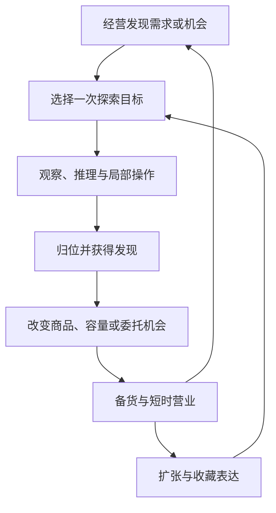

# 宇宙收藏家｜主循环、附循环与心流入口评审 V1

日期：2026-11-07。结论：**方向可继续，主循环需要修订；暂缓增加独立小游戏，先验证一次发现、一晚经营、一次有变化的回访。**

本文为设计评审和迭代建议，不覆盖原策划、不代表新规则已获确认。心流不能由文档或数值计算保证；以下方案旨在增加目标清晰、反馈及时、挑战可掌握的机会，需目标玩家试玩验证。

## 1. 证据与边界

### 已读取的材料

- 《梦中拾星_游戏策划文档.md》当前内容：v0.2，2026-10-21；首关、素材归位、三颗星星、提示、演出、合成储备。
- 《cosmic-collector-v2-offline.html》当前内容：2026-10-27版本；静态读取了探索、采购、手作、货架、营业、升级、周末玩法等规则。
- 当前会话提供的后续讨论记录：宇宙收藏家身份、探索经营约五五开、白天最多两次、夜晚营业、双线索委托、周末奖励日、普通SKU永久采购、高级SKU资格、仓储解谜、赶工恢复等。

后续讨论是设计意向，不等于原型已实现。旧文档与后续讨论冲突处单列，不擅自将一套改成唯一有效规则。本次没有运行游戏、没有真人试玩、没有游戏埋点数据；源码发现是静态事实，玩家体验判断是推断或假设。

采用游戏设计评审与游戏数值设计方法。评审覆盖体验、动作规则、挑战经济、谜题、空间节奏、注意引导、反馈可及性、主题、叙事和制作验证十个领域；排除多人社交竞争与社区治理，因为当前是单人原型。市场、发行、商业化合规不作专门评估；不评估Unity实现质量、资产性能或音乐同步精度。

## 2. 总判断：让两种玩法相互提出问题

现有框架已经有主题连贯的材料：梦境发现、声音归位、收藏、小店售卖。主要缺口是**它们还没有持续改变彼此的选择**。

“探索→归位→BOSS→商品”是内容推进链；当玩家知道谜题答案后，它本身不会自动成为可重复循环。经营若只是买入、上架、结算，也会迅速变成固定流程。两者需要靠具体需求与可见变化形成回路。

建议的跨日循环：

图中的BOSS是章节高潮，不是每次补货或每次回访的必经环节。新品发现、仓储机会和特殊委托也是不同目标，单次探索不必同时发放全部成果。

| 循环层级 | 玩家反复做的事 | 应得到的感受 | 当前要补的部分 |
|---|---|---|---|
| 秒级交互 | 观察→猜想→尝试→看到对象变化 | 我理解了，我的操作有用 | 世界变化不能只有文字提示 |
| 一次探索 | 明确目标→找证据→解决一个问题→归位/兑现 | 我完成了一件有意义的事 | 收集后成果与经营用途清楚 |
| 一晚经营 | 看需求→分配预算与货位→服务→看结果 | 我的准备和临场决定有作用 | 需求差异、可解释的营业操作 |
| 跨日循环 | 经营提出目标→探索扩大选择→回店试用 | 我想看看下一步会怎样 | 保留常规采购，避免每天强制刷主线 |
| 长期成长 | 发现新品→扩张→解锁更多内容选择 | 我的收藏与店铺越来越像自己 | 区分内容发现与经营能力成长 |

探索与经营约五五开应先作为整体体验方向，不要求每天严格各占50%，也不应用强制等待凑比例。

## 3. 优先发现与最小修订

### P0：探索首次结束后，经营没有继续依赖新的发现

**观察／事实：**原型在 `puzzle.solved` 后只展示探索完成；星星糖在初始状态已经开放采购。月光纸鹤由升级货架解锁，旋律瓶由雇佣解锁。不存在可反复选择的新委托。

**机制／推断：**商品成长来自店内升级，探索容易变成一次性教程。“宇宙收藏家”的主要身份没有持续落实；若反过来要求每天重刷同一关才能补货，则损害已确认的常规SKU采购便利。

**最小建议：**首次真正发现前不开放该发现的正式采购资格；教学库存可以单独提供并说明。常规SKU发现后永久采购。钱购买经营能力，探索发现商品题材、仓储谜题和委托解法。每晚只突出一个下一次探索机会，不把探索变成营业许可证。

**验证：**连续三日后，玩家能说明下一次探索的具体目的，并在经营中看到上次探索带来的变化。若只说“为了系统给钱”或“系统让我去”，循环仍弱。

### P0：需求与一键操作之间缺少需要玩家作出的取舍

**观察／事实：**源码所有顾客都接受任意现货替代；偏好商品没有满足也不一定产生损失。营业一次性循环结算。尚无可操作的找零或营业中服务。所谓“明日预报”实际按当前day计算偏好，时点表达不一致。

**机制／推断：**同样货位下，高毛利商品可能长期更优；玩家读预报没有必要。问题不在一键功能，一键只是让无意义重复更快暴露。

**最小建议：**先添加一个明确决策：顾客有可理解的购买类别，部分接受相关替代品，部分只接受指定类别。开门前显示本晚需求及数量范围，次日邮件单独标注。玩家决定备货比例，一键负责执行。营业先验证服务一个顾客、识别其需求、完成找零或一次补货的小片段，不同时加入保质期、盗窃、复杂物流。

**验证：**同预算、同容量的两种需求，应让玩家改变采购组合；同一组合不应所有场景都最优。分别观察“组合选择”和“找零动作”是否有趣，不能用高奖励替代操作体验验证。

### P0：环境解谜在原型中退化成了阅读与分类

**观察／事实：**旧文档已有挂绳止水纹、放垫安顿猫的因果链；原型则要求点完五个热点，做分类和剧情单选，再按屏幕明示顺序点四键。错键清空已点进度。

**机制／推断：**玩家可以不理解世界，只遍历和照做；即使顺利通关，也无法证明环境解谜的顿悟感成立。明白局部问题后还要先调查全部热点，会打断自己的思路。

**最小建议：**糖星只教交互；随后水、猫两题并行，局部证据充分即可尝试。恢复“证据→操作→对象改变”的因果链。手记整理可选，不作为全调查后的关卡门槛。归位保留正确部分，错位可撤回，提供试听与图形证据。

**验证：**玩家在操作前能说出“我要试什么、为什么”，成功后能解释原因。能解释但操作失败，修交互；只会遍历，修证据；不要直接加更多闪光提示。

### P1：附循环容易竞争收入，最终只剩收益最高的一项

**观察／事实：**方向中已有特殊委托、手作、周末音游，另有合成/塔防储备。原型手作不扣时段，可购买材料反复生产，工坊升级提高每份材料产量。

**机制／推断：**所有活动都无限产同一货币，会被归约为收益/分钟比较。提高某项奖金可以增加参与，却不能证明玩法本身耐玩。无限手作也可能替代采购与探索。

**最小建议：**分配清楚职责，见第5节。手作落实占时段规则；常规手作与破产救援分清成本。新玩法优先共享现有资源，但允许提供不同用途的奖励；不要每项新增专用货币。

**验证：**问玩家为何选择活动；在奖励相近时是否仍有不同偏好。小规模测试中降低额外奖金，观察是否仍有人自愿再玩，但不能据此要求所有人喜欢所有附玩法。

### P1：BOSS会突然从推理切换到未学过的节奏能力

**观察／事实：**旧文档不要求主线玩家擅长音游，后续讨论加入BOSS节奏挑战。周末原型只是看符号按顺序点击，没有节拍同步和时机判定。

**机制／推断：**推理熟练不代表节奏熟练；严判作为主线门槛可能在高潮前造成胜任感断层。符号记忆玩法不能证明音游心流。

**最小建议：**保留章节BOSS，但建议主线演出有宽容判定、分小节恢复和辅助路径；严格评分/全连作为精通目标。若BOSS必须严格节奏操作，应在前两关用极短片段教学同一能力，再验证轻度玩家是否能掌握。这是待确认的设计选择，不是删改既有方向。

**验证：**分别观察有、无音游经验的解谜玩家。看能否理解错误、第二次是否改善、是否愿意主动重试，以及辅助能否让其完成叙事。

### P1：惩罚、开门门槛和恢复供给可能相互卡住

**观察／事实与意向：**后续方向为至少10件开门，缺货影响客流；原型只要求货架非空，推荐补货到每SKU5件，手作需要材料。二者不能混当已实现规则。

**机制／推断：**若把10件门槛直接加到现有补货逻辑，一种SKU只推荐买5件，玩家会被推荐方案阻止开门。零资金、零材料时，付费买材料不能承担救援；客流下降又可能拖慢恢复。

**最小建议：**保留10件开门方向时，推荐采购按“开门缺口＋预计需求＋已有库存”生成。破产当日提供不依赖现金的赶工入口，一次占时段操作能获得足够开门的救援批次；售价和产量需另测，不沿用早期0.1示例。先测试损失未成交收入本身是否足够，再加入可见、有期限、可恢复的客流惩罚；拒绝未接的委托不算失败。

**验证：**零钱零货零材料、错购库存、连续两晚缺货、主动拒绝委托四个边界状态都能继续游戏；恢复不要求已用尽的资源。不要把无利可图误称为已经出现破产，当前原型无固定费用。

### P1：收藏本体与商品消耗的关系需要先定清楚

**观察／事实：**星星糖同时涉及剧情、能力、图鉴、可售商品和手作。旧文档有回响副产物建议，但尚未确认消耗本体还是副本。

**机制／推断：**玩家可能怕卖掉能力或永久收藏而囤货；后续合成会放大这种理解成本。

**最小建议：**至少明确三条玩家可预测的规则：发现记录永久保留；剧情/能力唯一物不可误耗；可交易数量可补充。售卖和委托交付前显示损耗对象。此为用途边界，不强制采用某套复制世界观。

**验证：**出售前让玩家预测“图鉴、能力、库存各会怎样”，再核对结果；若预测不符先改表达，后加新玩法。

## 4. 快速进入投入状态：先把一个动作闭环做顺

### 第一关5分钟的建议节奏

以下时间都是首轮测试假设，不是合格玩家标准，也不是心流保证。5分钟是常见完成目标，不设硬倒计时。

| 阶段 | 目标时点/区间 | 玩家在想什么 | 设计安排 |
|---|---|---|---|
| 接触 | 前15–30秒 | 我可以做什么 | 可见女孩、可听短旋律，一个清楚的交互；不先解释整个宇宙与商店 |
| 第一次成功 | 约30–60秒 | 我的动作让它回应了 | 糖纸展开→星形显露→声音接上；当前目标随之成立 |
| 第一次自主解题 | 接下来1–2分钟 | 我知道问题，想试一个办法 | 水/猫二选一；证据可见，目标不直接说答案 |
| 运用与变化 | 约第2–4分钟 | 我学会观察了，这次哪里不同 | 第二题使用相同交互语言，增加一个关系，不叠新按键系统 |
| 综合与释放 | 约第4–5分钟 | 我带回的东西组成了作品 | 三槽可试听归位，保留正确部分；短演出自然收束 |
| 回店承接 | 关卡完成以后 | 这份发现能在店里做什么 | 合并一次奖励展示，给一个具体首次售卖目标 |

35–45秒演出可能挤压探索容错。首次保留故事表达并测观看意愿；复访可跳过已看对白、教学、演出，直接进入新委托变化。不要以快进强迫初见玩家赶时长。

### 心流入口的四个实际检查

1. **目标清楚：**玩家能用自己的话说出当前想改变的状态，而非复述任务列表。
2. **反馈及时且有信息：**对象动作、声音与UI能说明尝试发生了什么；正确与错误都有局部信息。
3. **难度可掌握：**一次只增加一种未知关系；不会操作与不会推理分别提供帮助。
4. **中断可控：**不在解题途中连续弹奖励；失败局部修复；模式切换后保留上下文。

提示建议：先指出值得观察的关系，再指出局部对象，最后给下一步操作。可由玩家主动请求；无进展一段时间后只提示“可求助”，不按固定秒数自动剧透。音频、颜色和动态都要有必要的可视替代。

### 一天的连续目标链

白天“最多两次”是可用上限，不是必须刷满。每次出发优先一个目的，可选第二个。回店后将发现用于一项可理解的备货决策；夜晚结束只突出一个明天值得做的变化。通过自然收束切换模式，比缩短每个动画更重要。

## 5. 附循环的职责与回流

| 附循环 | 核心职责 | 何时进入 | 回流结果 | 必须避免 |
|---|---|---|---|---|
| 双线索特殊委托 | 让旧场景产生新推理 | 顾客需求触发，玩家主动接 | 明确交付奖励、发现/资格或关系进展 | 同答案换名字、未接也惩罚、强制清空全部委托 |
| 章节BOSS | 综合并形成高潮 | 已教学能力之后 | 章节完成与表现奖励 | 每次补货必打、突然要求未教过的操作 |
| 周末音游 | 短时熟练与奖励日 | 可选进入，短局优先 | 首局完整小奖励，后续追分/表现 | 只有打满3局才算完成、收益压倒经营 |
| 手作 | 主动补给与时间取舍 | 主动安排；破产当日引导救援 | 可售副本、恢复开门能力 | 无限无成本制造、用付费材料救零现金玩家 |
| 收藏/装饰 | 表达与长期目标 | 发现或赚到盈余后 | 看得见的店铺/收藏变化 | 大量领取红点和重复确认 |
| 合成/塔防储备 | 未来验证独立决策乐趣 | 现有循环通过验证后 | 先定义用途，再考虑正式经济 | 为了复玩立刻添加另一套刚需日常 |

周末是否继续夜间营业尚未定。本评审建议可直接结束奖励日并继续进度；如果停掉两晚营业，必须按完整一周比较收入与成长节奏，不能只比较单局奖金。

## 6. 特殊委托：重复的是操作，变化的是推理关系

“三种共享操作”尚未确定。本轮建议先用**观察关系、改变局部状态、组合验证证据**做候选语言；这不是已确认规则，也不要求把原有查看/放置强行合并成三个按键。

有效双线索应满足：单条线索各自留下多个候选，两条合起来缩小到明确目标。两条同义复述、一条已给唯一答案，均不应当作双线索深度。

### 最小可复用样板（建议新制作，非现成内容）

仅用星/月两种轮廓与糖/纸两种材质，制作四个低成本候选：星星糖、纸星星、月亮糖、纸月亮。素材需在局内能被观察确认，不能要求玩家猜属性。

| 候选 | 星形 | 月形 | 糖制可食用 | 纸制可折 |
|---|---|---|---|---|
| 星星糖 | 是 | 否 | 是 | 否 |
| 纸星星 | 是 | 否 | 否 | 是 |
| 月亮糖 | 否 | 是 | 是 | 否 |
| 纸月亮 | 否 | 是 | 否 | 是 |

- 委托A：“五个尖角”＋“可以折出一道痕迹”→纸星星。
- 委托B：“五个尖角”＋“能给孩子吃”→星星糖。
- 委托C：“弯弯的月牙”＋“可以折出一道痕迹”→纸月亮。

该样板用于验证双线索交集与证据表达，不应照搬成长期题库。三题都只是属性分类仍会疲劳；随后至少一题应要求改变局部状态才能观察第二条证据，或比较两条来源的可信范围。不要新增陌生操作、再把玩家的操作不熟误当推理难度。

内容制作先手工写3题并验证唯一性，再做模板。每题记录候选集合、两条证据各排除谁、必要状态、提示三级、交付与失败后果。随机化只从已验证组合抽取，不生成可能无解或多个答案的题。

高级商品“重复至少3次或完美通关”仍是讨论方向。建议比较“相同主线重复3遍”与“完成3个不同有效委托”：后者更能检验理解，也减少背答案。完美路径不宜永久锁住轻度玩家；具体替代路径待测。

## 7. 数值核验：现有原型的几个结构问题

采用临时Python校验器独立复现源码售卖顺序。单位为宇宙币、件；默认6名顾客，每人买1件，无固定经营费用。利润在下表指已售商品毛利，不含未来费用。这里只评估当前源码的局部规则，不代表完整游戏经济模拟。

### 7.1 无限制替代使高毛利商品胜出

设定所有SKU已解锁、需求偏好星星糖、预算40、货位10，比较同样6件库存：

| 备货 | 采购成本 | 售出件数 | 营业额 | 已售毛利 | 未满足 |
|---|---:|---:|---:|---:|---:|
| 星星糖6件 | 12 | 6 | 18 | 6 | 0 |
| 月光纸鹤6件 | 24 | 6 | 48 | 24 | 0 |
| 旋律瓶6件 | 36 | 6 | 72 | 36 | 0 |

已枚举预算≤40、库存总量≤10、各SKU整数0–10的全部可行组合；该状态下最大已售毛利36，唯一最优为旋律瓶6件。说明在这个预算与解锁状态下，需求偏好不能约束选择；不代表低现金、未解锁或以后不同需求规则下它始终最优。

**判断：修订。**先限制购买类别、定义可接受替代，再调售价；直接压低旋律瓶毛利会掩盖需求机制失效。

### 7.2 推荐5件与6名顾客在首夜已冲突

当前推荐把每SKU的仓库+货架补足到5件；仅星星糖可用、无额外手作时，上架5件，6人到店，会售5件、收入15、毛利5、遗漏1人。源码因此减少口碑2点、次日客流1人。

这不是随机倒霉，而是推荐数量与已知人数不匹配。若加入10件开门要求，会进一步冲突。推荐方案需要基于需求与开门缺口，而非永远每SKU5件。

### 7.3 周末现金不能单独判定“太少”

源码3轮奖励依次7、9、11，共27币/奖励日，另3份材料。它是符号顺序玩法，没有测得的真实音游局长。对比基础商品：6件星星糖一晚毛利6；6件旋律瓶一晚毛利36。于是同样27币对早期和后期的意义很不同，且奖金为现金、毛利需扣采购成本，不能混为营业额。

**判断：证据不足。**先决定周末营业和每局时长，再用“完整一周收入、奖励耗时、成长提前多少天”衡量。不建议现在凭感觉继续加奖或减奖。

### 7.4 手作与救援边界

源码材料2份售价3币，即单份成本1.5；工坊等级L每份产1+L件星星糖。采购同商品成本2。因此不计时间时手作单件成本=1.5/(1+L)，基础就比采购便宜，升级后差距持续扩大。按L=0/1/2，单位材料成本为1.5/0.75/0.5。没有时段成本时，手作可能替代采购；真实判断需加入材料来源与操作时间。

零钱零材料时，当前买材料和制作都不可执行。原型每日送1材料能慢慢恢复，但若日后加10件开门而没有额外恢复规则，基础手作需要累计10份，已不符合“破产当日赶工后仍可营业”的目标。这个组合是风险场景，不是说当前源码已执行10件门槛。

**判断：修订。**先补救援资源来源与时间机会成本，再调工坊产量、售价和升级价格。

校验包括已知手算案例、普通库存、预算最优组合、推荐不足、周末奖励。无随机过程，不需要随机种子；枚举使用确定性穷举。临时脚本与临时输出已清理，公式、输入、结果保留于本文。未建完整长期模拟器，因为缺少统一现行经济表与周末规则；不以这些局部计算声称已平衡。

## 8. 以后加入新玩法的准入卡

用设计边界支持扩展，不先建设通用大框架。每个候选玩法先填这一页：

| 必填项 | 要回答的问题 | 暂缓信号 |
|---|---|---|
| 玩家主动理由 | 为什么此刻想玩，解决什么需求 | 只有“不玩少领一笔钱” |
| 新决策 | 与已有玩法相比，玩家多了一种什么取舍 | 换皮点击、同解法换名称 |
| 共享基础 | 复用哪些角色、物品、操作或反馈 | 一次新增多套按键、材料、货币、教程 |
| 时间与进入 | 花费哪个时段，能否退出/稍后再玩 | 必须每天做完所有活动 |
| 回流与上限 | 带回什么，如何影响收藏/经营，是否可无限产币 | 自循环无限获利、替代全部主玩法 |
| 失败恢复 | 丢失什么，如何重试，跳过有什么后果 | 误耗唯一物、不可逆卡关、双重惩罚 |
| 内容成本 | 新增一关/一题需要做哪些差异内容 | 每个变体都重做地图和独立界面 |
| 验证与退出条件 | 多小的样板能证明价值，失败如何移除 | 只能做完整系统才能知道好不好玩 |

正式接入前，先用现有场景做一个样板。新玩法可以探索新的能力，但要在自然边界进入、局内完成教学、有清晰回流；不能要求所有新玩法共享相同按钮，也不能为了“通用”牺牲其乐趣。

主线唯一物、永久发现、可售库存的损耗边界，以及活动时间、结算顺序、保存/恢复行为，要成为所有玩法遵守的共同约定。这里描述的是设计约定，不指定程序架构。

## 9. 最小下一轮验证与迭代顺序

### 验证切片

只用一个街角、两种常规商品、一个货架、一个有效委托：

1. 一次真实因果解谜，玩家操作能改变水或猫的状态。
2. 一次归位与发现，随后一次售卖让玩家看到用途。
3. 一晚有预算/货位约束的需求选择；营业操作单独验证。
4. 一个回访委托让之前的答案不再总正确，完成后改变次日经营选择。
5. 零资源救援入口可实际走通。

首次试玩先测前5分钟；随后另测连续三日，不能把两者硬挤成一个5分钟Demo。音游另做一段短乐句验证判定与反馈，再决定是否接入主流程；合成暂缓。

### 试玩计划（小样本探索，不作统计保证）

先找5–8名未看过答案的目标玩家，尽量包含轻度解谜和不同音游经验。操作中不持续要求大声思考，以免干扰节奏；记录行为，在自然停顿和结束时追问原因。

| 观察项 | 第一轮目标假设 | 未达到时先改什么 |
|---|---|---|
| 首次有效操作 | 约30秒内，允许个体差异 | 交互可见性、入口文字 |
| 当前目标理解 | 首次反馈后多数能说明 | 动机与目标表达 |
| 自主因果理解 | 5人中至少4人能解释一个成功原因 | 证据与操作结果，而非增加任务 |
| 卡住与恢复 | 不会因漏读一个无关热点而全局阻塞 | 移除串行门槛、补局部提示 |
| 经营决策 | 两种需求下能做出有理由的不同组合 | 需求后果与信息时点 |
| 回访变化 | 能解释这次为何不能照旧答案 | 证据关系与候选设计 |
| 可选活动 | 愿意说明选择/跳过的理由 | 职责和收益，不强求参与率 |
| 连续三日目标 | 能说出下一次探索的具体理由 | 双向循环联系 |
| 失败恢复 | 零资源边界仍能回到可玩状态 | 救援供给和门槛 |

“30秒”“4/5”均为本轮判读起点，不是行业标准。若玩家长时间在主动推理且享受，不因超时自动判失败；若很快完成但只会照提示，也不认定进入心流。记录自发重试、目标清晰度、挑战感与主观投入程度，结合观察判断。

### 迭代闸门

- 第一步：先修因果解谜与首次发现，确认操作闭环。
- 第二步：接一晚经营，验证需求是否真的改变决策。
- 第三步：接回访委托，验证三日动机链及内容复用。
- 第四步：验证BOSS/周末音游的技能过渡，再接奖励。
- 第五步：只有当新玩法准入卡与小样板通过，才增加合成等独立玩法。

每次只改变一个主要原因，保留前后版本与试玩观察。经营目标达成但服务操作无趣时，改操作；玩家不理解线索时，改证据；收益失衡时再调数值。不要一次性重做所有环节而失去判断依据。

## 10. 尚待决定、但不阻碍本轮验证的事项

| 未定项 | 本评审的临时建议 | 会影响的后续工作 |
|---|---|---|
| 周末是否夜间营业 | 单独比较营业/不营业两种周节奏 | 全周经济与奖励 |
| 严格音游是否主线硬门槛 | 宽容通关＋可选精通，保留BOSS | 教学、辅助、受众 |
| 雇佣后“仍需探索”的含义 | 探索提供成长与新机会，常规补货仍采购 | 防挂机与强制刷关边界 |
| 高级SKU三次资格 | 比较不同委托记录与重复同关 | 疲劳与成长速度 |
| 三种共享操作 | 先验证观察、状态改变、证据组合 | 委托模板 |
| 手作售价/产量 | 不沿用0.1；先保证救援与占时段规则 | 经营机会成本 |
| 商品副本与回响关系 | 先明确可耗与不可耗，再定世界观 | 库存、合成、能力 |

推荐优先落实的不是更多玩法，而是这条可被体验和验证的目标链：**我在店里产生一个愿望，去梦里解决一个问题，带回一个改变，再想试一次不同的安排。**
