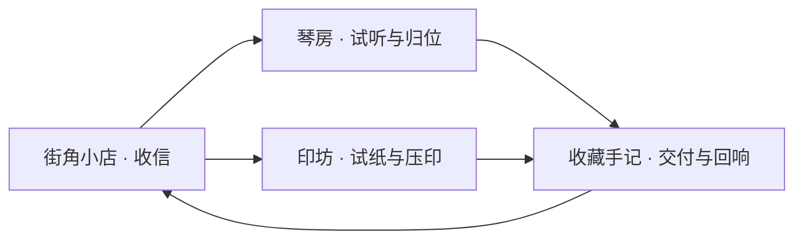

# 《宇宙收藏家》界面与探索扩展 · 第一轮评审

以 V7 画册版为基线。本轮交付探索、经营两张美术概念图，以及一份独立界面样机。两张新场景与六个委托是待审方案。本文含谜底。

## 一、两个主要界面

| 画面 | 第一眼应该看到什么 | 一次动作如何反馈 | 需要时才出现的信息 |
| --- | --- | --- | --- |
| **探索 · 星光街角** | 木框、莉丝、折纸台分别处在三处光区。物件上是小型符号，底部保留三个短标签，便于初次游玩和触屏。 | 点木框后，样品试进框槽。太宽就卡在框外。压纸后看到折线或回弹。样品卡上同步出现 ✓ 或 ×。 | 原信和提示单独打开。工作板只在选中地点后出现，保留当前样品及其记录。 |
| **经营 · 备货** | 十格实物木柜里能数出货和空位。预约单只显示商品形状与数量，现金常驻右上。 | 上架后空格被填上，开门按钮由暗变亮。货量或门面条件不足时，只显示当前缺项。 | 三种门面用短标签区分。主题橱窗仍直接显示概率和亏损／获利，账簿展开后再解释条件。 |
| **经营 · 收银** | 一张订单、一组应收／实收／应找金额和三种钱币。 | 选币更新合计。金额正确后确认按钮点亮，结账换下一张票。 | 撤回与快捷结账留在当前柜台。全部结清后显示一张打烊小票。 |

### 美术与 UI 的交界

- **场景画法。** 参考 PPT 第 15 页街灯的冷暖光区、第 18 页琴房的色面和木器。外景用蓝灰和夜色，木框、折纸台、橱窗用暖光指路。店内用暖木、黄铜和少量暗酒红，物件轮廓优先于装饰。
- **两套界面共用同一种交互语言。** 实心奶油金表示当前主要动作，细线框表示可选项，✓ 与 × 随状态出现。重要数字和结果依然可读，颜色只是辅助。
- **上机规则。** 探索物件与点击区域分层，订单和库存由可交互 UI 绘制。柜体、商品和格位最终拆开，十格各对应一个库存单位。当前图上呈现的是美术方向，格位和数量以样机叠加层为准。
- **取舍。** 样机内备货与收银采用一组固定演示订单，方便评审可读性。实际门面结算、顾客概率、金币与 V7 存档由后续正式接入负责。

## 二、两个新场景

暂定在现有第三天的月牙甜点委托之后开放。玩家从来信选择去哪一处，解锁可按委托关系推进。两张地图各复用一张主要画面，通过开窗、谱页、纸样或灯光变化支持三次回访。

| 地点 | 玩法角色 | 三处画面焦点 | 场景完成后的变化 |
| --- | --- | --- | --- |
| **莫扎特家的琴房** | 从一段声音追到造成它的人或物，适合接续「声音归位」主题 | 左侧窗边与乐盒 · 中央琴谱和键盘 · 右侧谱灯与弓手座 | 琴谱多一页，琴房从各自练习变成合奏。可复用 PPT 第 18 页琴房构图，人物、光区、可交互道具单独处理。 |
| **河畔印坊** | 把纸张、湿度、工序和印记变成可操作的证据。让纸星委托里的试装与折痕经验有后续用途 | 左侧纸架 · 中央压印台 · 右侧河窗与晾纸绳 | 晾纸绳挂起刚完成的作品。首轮使用同一机位、同一工作台，通过三组小道具区分回访。 |

来信说明要帮谁和眼下出了什么事，场景物件提供解法，交付改变场景。经营端可以随后出现一次熟客来访或展示物陈列。已有现金、当晚销量和评级继续由经营自身产生。首轮建议先把新增委托奖励设为收藏、可见的场景变化，以及少量一次性订单机会，等你确认探索与经营的联动深度再定现金和商品许可。

## 三、六个委托样板

难度和用时是设计目标，待试玩修正。三个基础操作为 **试验对照、摆放归位、操作验印**。任务可以共享同一组卡片、试验反馈和复位按钮。静音时通过波形长度、明暗与形状提供同等证据。

| 委托 | 来信开头 | 玩家要做什么 | 证据和唯一解 | 场景与手记回报 |
| --- | --- | --- | --- | --- |
| **琴房 ①《让尾音停下来》** · 入门，约 2 分钟 | 「刚好要收尾，它却还在响。」 | 试塞三块消音样片，再试听或看余音线。 | 白毡窄且收声快，麻布窄但拖音，蓝毡过宽但收声快。琴键下只有窄缝，谱上短划线示意短尾音。选白毡。 | 多余尾音消失。手记收录安静的琴键。 |
| **琴房 ②《散开的三句》** · 标准，约 3 分钟 | 「我记得第一句和最后一拍，中间两处接不上了。」 | 试听三张谱片，翻转一张双面谱片，把相邻声纹接起来。 | 琴谱给起点圆、终点菱形。首尾片分别为圆→三角、方形→菱形。中间片正面为三角→圆，背面为三角→方形。翻到背面再放到中间，每片只能使用一次。正确拼接后试听完整乐句。 | 谱架亮起完整曲句，解锁一页可回听手记。 |
| **琴房 ③《给弓手留把椅子》** · 标准，约 3–4 分钟 | 「等大家坐好，我就能翻到第二页。」 | 根据物件归属安排窗位、中央位和谱灯位。 | 键手要触到固定在中央的键盘，弓手需要谱灯读谱，乐盒留在窗位。纸条写「乐盒只借座，不用看谱」，排除看似也适合谱灯的乐盒。 | 三个位置依次响起，合成琴房合奏的短反馈。 |
| **印坊 ①《河雾里的货签》** · 入门，约 2 分钟 | 「挑张纸，沾了雾也能看清。」 | 在试纸架上压出印记，再蘸一滴水看变化。 | 厚白纸成像清楚但遇水晕开，粗布耐水但压印断线，上蜡薄卡清楚且耐水。选薄卡。 | 晾绳出现一张清楚的货签，手记记录纸张样本。 |
| **印坊 ②《谁先按下压杆》** · 标准，约 3 分钟 | 「印痕只剩半边，角也跑了。」 | 观察废样，复原夹纸、压印、揭纸三步。 | 压前夹纸才不会偏。压杆回位后的空隙允许揭纸。把「夹 → 压 → 揭」摆到三格后试印，错序可查看偏移或拖影再复位。 | 完整印样挂上晾绳。 |
| **印坊 ③《两枚叠印》** · 进阶，约 3–4 分钟 | 「星得落在窗里，印框上别留缝。」 | 试转透明的第二张纸版，观察框和星的重合。 | 四档可试。0° 框不合且星在外，90° 框合但星在外，180° 框不合但星在内，270° 两项都合。先给半成品对齐示范；两项均成立才允许成品验印。 | 河窗前出现完整的叠印。首轮作为收藏图，后续可试柜台展品。 |

逐项枚举两项证据、谱片正反、座位排列、工序顺序和纸版朝向，这六个初稿各有一个解。具体光效、位置和提示能否让初次游玩的玩家独立读懂，仍要用上机小样检验。

每个场景优先做一条能走通的代表委托，再补同场景的两条变体。首错提示反馈物理结果，如「木槽挡住了纸」或直接显示拖影。第二级才指出要比较哪两项，最后一级给下一步操作。探索顺序错了可以复位或暂放来信，已经看见的证据仍可核对。首次完成写入进度和场景，复玩主要用于回看反馈。

## 四、评审时请看这三件事

1. **镜头与美术。** 当前方案采用一张固定 2D 场景画，点物件后展开操作。请确认它是下一版 MVP 的目标形态，还是你希望在 MVP 就能走动的空间原型。
2. **两个场景的主线位置。** 建议琴房承接音乐宇宙的后续章节，印坊是同城回访支线。也可以把两处都做成委托地图，让玩家自由往返。
3. **委托对经营的影响。** 建议先让委托改动街景并触发一次熟客小事件。若你想让探索和经营更紧，可以改为每张新地图各解锁一种可持续经营的商品，再一起定成本、需求和开门影响。
